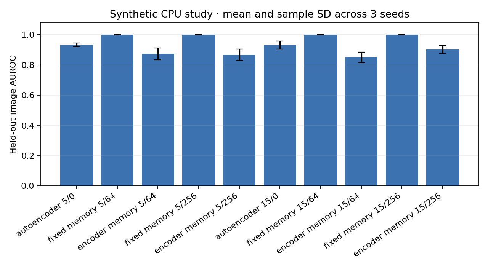

# Few-shot surface anomaly detection with independent calibration

A normal-only inspection study comparing fixed patch descriptors, features from a small normal-trained encoder and autoencoder reconstruction error. Each method learns from 5 or 15 normal images. A separate normal calibration set determines alarm thresholds before held-out testing.

The project investigates the distinction between ranking anomalies, localizing defects and deciding when to alarm. It also measures how the memory budget and feature source affect those tasks.



## Implemented methods

| Method | Fitted representation | Anomaly score |
|---|---|---|
| Fixed patch memory | Standardized intensity-residual, gradient and texture patches | Distance to nearest normal prototype |
| Encoder patch memory | Intermediate features from a small normal-only trained autoencoder | Distance to nearest normal prototype |
| Autoencoder | Convolutional reconstruction model | Absolute pixel reconstruction error |

Both memory variants use deterministic farthest-first coreset selection with budgets of 64 or 256 prototypes. Exact nearest-neighbor queries are chunked to bound the temporary distance matrix. The fixed descriptor has 100 dimensions at stride four. Memory feature normalization is fitted on normal fit images only.

This is a patch-memory and reconstruction study. It does not reproduce PatchCore: no pretrained ImageNet backbone, approximate nearest-neighbor library or published benchmark result is used.

## Run

Create a Python virtual environment:

```bash
python -m venv .venv
```

Activate it with `source .venv/bin/activate` on Linux/macOS or `.venv\Scripts\Activate.ps1` in Windows PowerShell. Then:

```bash
python -m pip install torch==2.5.1 --index-url https://download.pytorch.org/whl/cpu
python -m pip install -e ".[dev]"
python -m pytest -q
python -m fewshot.run --config configs/smoke.json --out runs/smoke
python -m fewshot.run --config configs/demo.json --out runs/reproduction
python tools/report.py --results runs/reproduction
```

Tested with Python 3.12.14 and PyTorch 2.5.1+cpu. The demo runs three seeds, two shot budgets and two memory budgets. A pool of 40 normal images supplies nested 5-/15-image fit subsets. Each model additionally uses **32 separate normal calibration images** and is tested on 80 images, half normal and half defective. Thus, 15 shots means 15 fit images, not 15 images in the entire workflow.

## Scoring and calibration

For normal patch features `f`, compute a mean and standard deviation from fit images, with a standard-deviation floor. Greedy farthest-first selection builds a representative prototype bank in that standardized space. At inference, each patch receives the minimum Euclidean distance to a stored prototype. For fixed descriptors, projection to the image grid preserves patch-center coordinates at 0, 4, 8, … pixels. Encoder features use bilinear projection from their feature grid.

The image score is the average of the highest-scoring 1% of pixels. This reduces dependence on a single noisy pixel while preserving sensitivity to local defects. It may dilute anomalies substantially smaller than that tail fraction; this choice is part of the operating definition, not a universal default.

The image alarm threshold is a split-conformal upper order statistic computed only from normal calibration scores. At target normal false-alarm probability `alpha`, sort `n` calibration scores and select rank `ceil((n+1)*(1-alpha))`. Alarm only when the new score is strictly greater than the threshold. If the rank exceeds `n`, the threshold becomes infinity because the calibration budget cannot support a finite threshold at that level.

The marginal normal false-alarm bound requires exchangeability between calibration and future normal images. New illumination, material or camera conditions can invalidate that assumption. The pixel threshold is an empirical 99.5th percentile of calibration pixels; it carries no image-level false-alarm guarantee because pixels within one image are correlated.

## Measured results

With 15 normal fit images and a 256-prototype budget:

| Method | Image AUROC, mean ± sample SD | Pixel AP | Defect recall at calibrated threshold |
|---|---:|---:|---:|
| Fixed patch memory | 1.0000 ± 0.0000 | 0.4603 | 1.0000 |
| Encoder patch memory | 0.9031 ± 0.0258 | 0.3185 | 0.1917 |
| Autoencoder | 0.9329 ± 0.0267 | 0.6603 | 0.6333 |

These are actual **procedural synthetic CPU results**. The fixed descriptor is well matched to the generator's contrast and texture changes, making image ranking unusually easy. Perfect AUROC here is not evidence of perfect real-world detection, precise masks or reliable performance under distribution shift. Its pixel AP is much lower than its image AUROC. The encoder's decent ranking also coexists with low recall at the conservative calibrated threshold.

See [all 30 experiment cells](results/demo/EXPERIMENTS.md), [raw metrics](results/demo/metrics.json) and per-image CSVs. Wilson intervals quantify recall/false-alarm uncertainty; AUROC bootstrap intervals resample complete images. Seeds vary the normal fit subset and encoder initialization while retaining the same held-out test set.

## Checkpoint inference

```bash
python tools/export_dataset.py --normal-only-fit --out data/example
python tools/validate_data.py --root data/example
python -m fewshot.infer --checkpoint results/demo/handcrafted_memory_shots15_k256_seed7.pt --image data/example/test/0001.png --out runs/prediction
```

Outputs are a raw anomaly map, thresholded localization PNG and image decision JSON. Checkpoints contain memory, fit normalization, optional encoder weights and both calibrated thresholds.

## Private data

Provide `manifest.csv` using [DATA_CONTRACT.md](docs/DATA_CONTRACT.md). Both `train` and `cal` must be normal-only; the runner checks masks before fitting. A defective test image needs a pixel mask so localization can be measured. Keep component and batch groups disjoint.

```bash
python -m fewshot.run --root /path/to/category --config configs/demo.json --out runs/private_category
```

## Code map

| File | Purpose |
|---|---|
| [models.py](src/fewshot/models.py) | Features, coreset, memory, reconstruction and calibration |
| [run.py](src/fewshot/run.py) | Fit/calibration/test protocol and uncertainty |
| [infer.py](src/fewshot/infer.py) | Restoring a fitted model and applying its threshold |
| [German technical guide](docs/TECHNICAL_GUIDE_DE.md) | Mathematical reasoning and detailed review questions |
| [Model card](docs/MODEL_CARD.md) | Evidence, target use and remaining validation |

Tests verify unique coreset indices with duplicate features, monotone coverage radius, query chunk invariance, finite-sample threshold behavior and unfitted-model rejection. Distance computation deliberately uses the direct Euclidean path to avoid cancellation near exact prototype matches.

## References

- [Roth et al., Towards Total Recall in Industrial Anomaly Detection](https://arxiv.org/abs/2106.08265), for representative normal patch memories.
- [Angelopoulos and Bates, A Gentle Introduction to Conformal Prediction and Distribution-Free Uncertainty Quantification](https://arxiv.org/abs/2107.07511), for split-conformal calibration principles.
