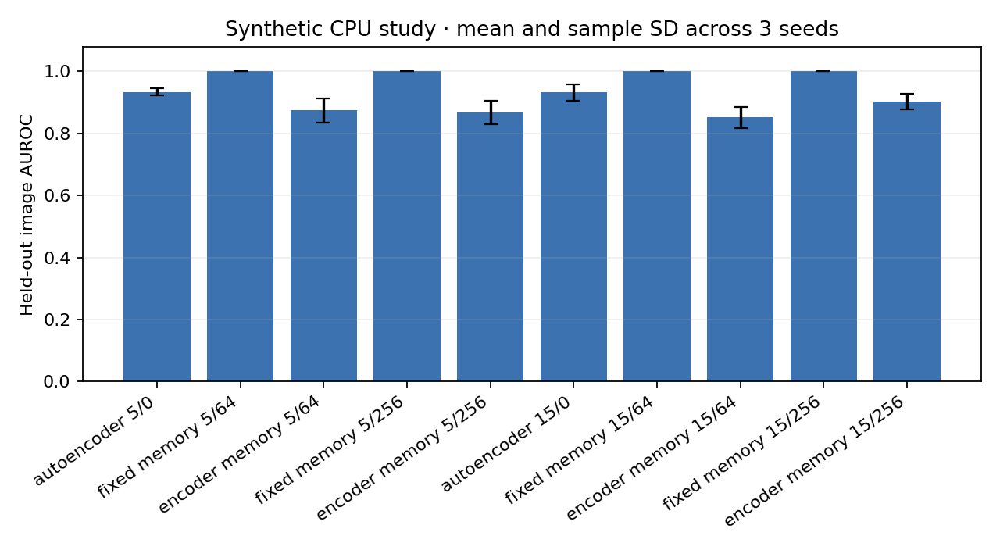

# Recorded experiments

Data: **procedural synthetic only**. Seeds: `[7, 17, 27]`. Measurement recorded: `2026-11-24T19:36:46.894291+00:00`.

| Method | Normal fit images | Memory budget | Image AUROC (mean ± SD) | Pixel AP | Defect recall | Normal false alarm rate |
|---|---|---|---|---|---|---|
| autoencoder | 5 | — | 0.9340 ± 0.0113 | 0.6510 | 0.6333 | 0.0083 |
| handcrafted_memory | 5 | 64 | 1.0000 ± 0.0000 | 0.4626 | 1.0000 | 0.0083 |
| encoder_memory | 5 | 64 | 0.8742 ± 0.0392 | 0.2634 | 0.2000 | 0.0000 |
| handcrafted_memory | 5 | 256 | 1.0000 ± 0.0000 | 0.4645 | 1.0000 | 0.0000 |
| encoder_memory | 5 | 256 | 0.8671 ± 0.0371 | 0.2618 | 0.2000 | 0.0000 |
| autoencoder | 15 | — | 0.9329 ± 0.0267 | 0.6603 | 0.6333 | 0.0083 |
| handcrafted_memory | 15 | 64 | 1.0000 ± 0.0000 | 0.4608 | 1.0000 | 0.0000 |
| encoder_memory | 15 | 64 | 0.8517 ± 0.0334 | 0.2978 | 0.1917 | 0.0000 |
| handcrafted_memory | 15 | 256 | 1.0000 ± 0.0000 | 0.4603 | 1.0000 | 0.0000 |
| encoder_memory | 15 | 256 | 0.9031 ± 0.0258 | 0.3185 | 0.1917 | 0.0000 |

The shot budget counts fit images only. The 32 independent normal calibration images are additional. Thresholds use calibration scores only, with a strict greater-than alarm rule. Bootstrap intervals resample images, not pixels; per-seed intervals and Wilson intervals are in metrics.json. Encoder memory uses a normal-only trained small autoencoder, not an ImageNet network. This study does not reproduce PatchCore and uses no external benchmark.

## Reproduction record

The complete configuration, data audit, runtime versions, source SHA-256, raw per-run metrics and available per-image CSVs are retained beside this report. CPU batch size, warm-up and repeat counts are stored with each timing. A source digest identifies the package Python files used for the recorded run. Model checkpoints contain tensors and inference metadata; optimizer state is intentionally omitted.

## Practical limits

Procedural defects have a narrow appearance distribution and exact generated masks. High scores on this generator do not establish performance on real materials, cameras, lighting, unseen defect types or production batches. Test images were used for the reported comparisons; choose any future production model using a separate validation protocol and reserve another untouched real test set.
